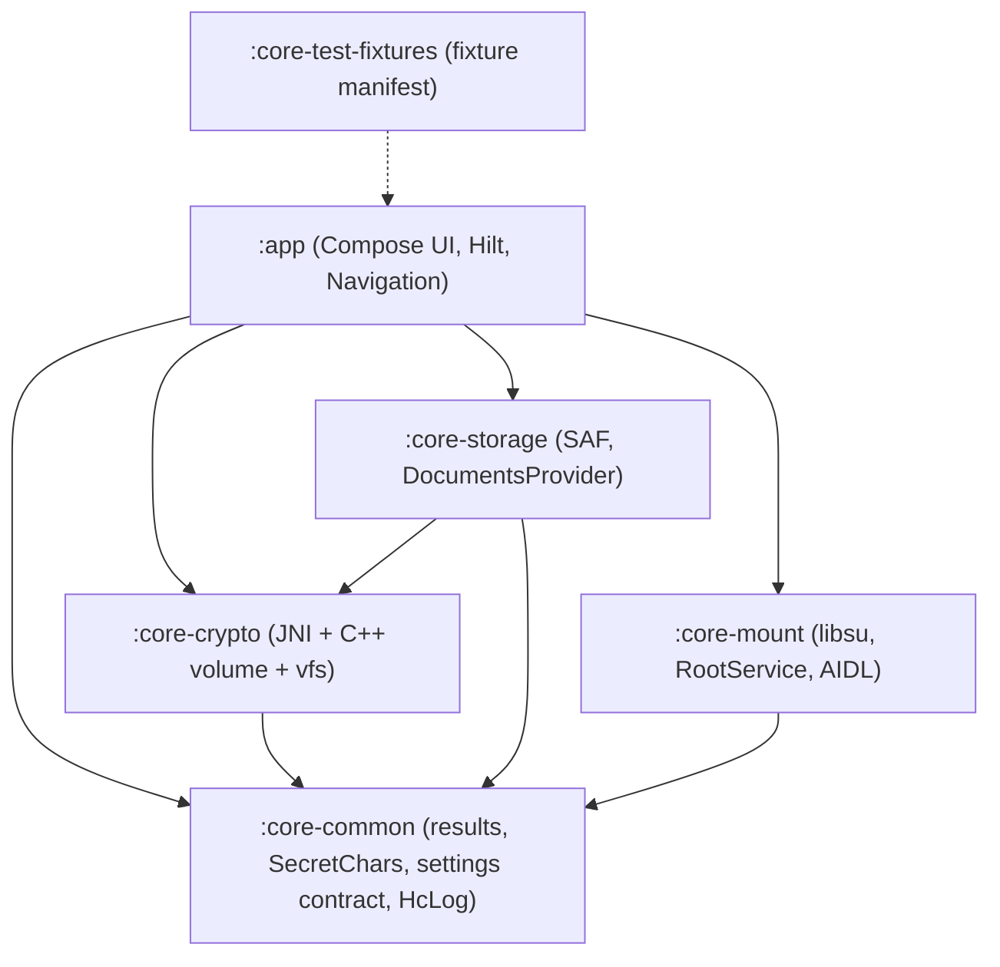

# Architecture

Decision record for HCVault. Reference baseline: Kotlin 2.x, Compose + Material 3, minSdk 28,
targetSdk 36, NDK r27 (LTS), CMake 3.22.1, Hilt, coroutines/Flow, libsu 6.

## Gradle modules

- `:core-crypto` knows nothing about Android UI or SAF. It receives an integer file descriptor and
  returns a `VolumeSession`.
- `:core-mount` holds no crypto code; the mount daemon links the same native `veracrypt_volume`.
- A narrow C ABI (`vc_*`) separates Kotlin from the upstream VeraCrypt code and its license.

## Crypto-layer decision

Upstream VeraCrypt (subset of `Common/`, `Crypto/`, `Volume/`, pinned tag, vendored). Reasons and
license consequences: see `docs/licenses.md`. The C ABI keeps the implementation replaceable.

## Mounted mode (planned)

Loop alone does not decrypt a VeraCrypt container. The design is:
decrypting FUSE image (`plain.img`) -> `losetup` -> kernel `mount` -> optional bind, executed by a
libsu `RootService` (daemon mode) in the mount-master namespace. A `dm-crypt` fast path may be added
where the kernel supports it.

## Settings and secrets

Passwords, PIM, keyfiles and keys exist only in memory (`SecretChars`, wiped after use). The
settings store (`SettingsStore`) holds non-sensitive values only and is backed by
`EncryptedSharedPreferences`.

## Build conventions

`build-logic/` provides convention plugins: `hcvault.android.application`, `hcvault.android.library`,
`hcvault.android.compose`, `hcvault.android.hilt` and `hcvault.quality` (detekt with ktlint rules).
SDK levels and NDK/CMake versions come from `gradle/libs.versions.toml`.
