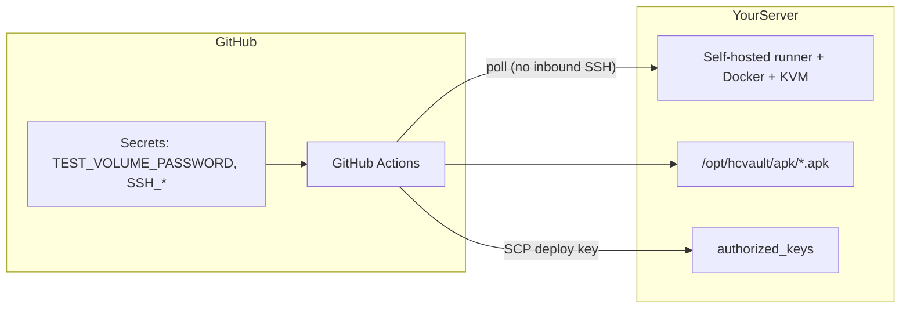

# GitHub Actions: автотесты и деплой на свой SSH-сервер

В репозитории три режима CI:

| Workflow | Где выполняется | Что делает |
|----------|-----------------|------------|
| [`ci.yml`](../.github/workflows/ci.yml) | GitHub `ubuntu-latest` | Быстрый job без KVM + полный прогон с эмулятором, если на раннере есть `/dev/kvm` |
| [`ci-self-hosted.yml`](../.github/workflows/ci-self-hosted.yml) | **Ваш сервер** (self-hosted runner) | Полный `docker compose run android-ci` с instrumented-тестами |
| [`deploy.yml`](../.github/workflows/deploy.yml) | GitHub + **SCP по SSH** на сервер | Сборка debug APK и выкладка в каталог на сервере |
| [`nightly.yml`](../.github/workflows/nightly.yml) | Self-hosted | Ночной полный прогон (опционально) |

Локальная логика тестов не меняется: всё по-прежнему идёт через `scripts/ci/run-local.sh` в Docker — см. [testing-docker.md](testing-docker.md).

---

## Вариант A: автотесты с KVM на **вашем** SSH-сервере (рекомендуется)

GitHub **не** подключается по SSH, чтобы гонять тесты. На сервере ставится [self-hosted runner](https://docs.github.com/en/actions/hosting-your-own-runners/managing-self-hosted-runners/about-self-hosted-runners): он сам опрашивает GitHub и выполняет workflow.

### 1. Подготовка сервера (по SSH вы заходите как обычно)

На Debian/Ubuntu (пример):

```bash
sudo apt-get update
sudo apt-get install -y docker.io docker-compose-v2 git curl
sudo usermod -aG docker,kvm "$USER"
# перелогиньтесь, чтобы группы применились
groups   # должны быть docker и kvm
test -c /dev/kvm && echo "KVM ok"
```

### 2. Регистрация runner в GitHub

1. Репозиторий → **Settings** → **Actions** → **Runners** → **New self-hosted runner**.
2. Выберите **Linux** → скопируйте команды `config.sh` (токен одноразовый).
3. На сервере (отдельный пользователь, например `hcvault-ci`):

```bash
sudo useradd -m -s /bin/bash hcvault-runner
sudo usermod -aG docker,kvm hcvault-runner
sudo su - hcvault-runner

mkdir -p ~/actions-runner && cd ~/actions-runner
curl -fsSL -o actions-runner-linux-x64.tar.gz \
  https://github.com/actions/runner/releases/download/v2.321.0/actions-runner-linux-x64-2.321.0.tar.gz
tar xzf actions-runner-linux-x64.tar.gz

# Подставьте URL и TOKEN из страницы GitHub Runners:
./config.sh --url https://github.com/OWNER/AndroCrypter \
  --token TOKEN \
  --name hcvault-kvm-1 \
  --labels self-hosted,linux,kvm,hcvault \
  --unattended

sudo ./svc.sh install hcvault-runner
sudo ./svc.sh start
```

В UI runner должен быть **Idle** с метками `self-hosted`, `linux`, `kvm`, `hcvault`.

Workflow [`ci-self-hosted.yml`](../.github/workflows/ci-self-hosted.yml) сработает на этом раннере. Для PR и `main` можно отключить дублирование с облачным `ci.yml` (оставить один из них), если не нужны два прогона.

---

## Вариант B: деплой APK **на** сервер по SSH

Здесь как раз нужна пара SSH-ключей: Actions **подключается к вашему серверу** по SCP/SSH.

### 1. Создать ключ (на **вашей** машине или на сервере — главное, хранить приватную часть только в GitHub Secrets)

```bash
ssh-keygen -t ed25519 -a 64 \
  -C "github-actions-hcvault-deploy" \
  -f ./hcvault-github-deploy \
  -N ""
```

Файлы:

- `hcvault-github-deploy` — **приватный** (в репозиторий не класть)
- `hcvault-github-deploy.pub` — **публичный**

### 2. Добавить публичный ключ в `authorized_keys` на сервере

Под пользователем, в домашний каталог которого будете класть APK (например `deploy`):

```bash
# на сервере, под пользователем deploy:
mkdir -p ~/.ssh && chmod 700 ~/.ssh
cat hcvault-github-deploy.pub >> ~/.ssh/authorized_keys
chmod 600 ~/.ssh/authorized_keys
```

Каталог для APK (пример):

```bash
sudo mkdir -p /opt/hcvault/apk
sudo chown deploy:deploy /opt/hcvault/apk
```

### 3. Секреты в GitHub (Repository secrets)

**Settings → Secrets and variables → Actions → New repository secret**

#### Обязательные для автотестов с фикстурами

| Secret | Описание |
|--------|----------|
| `TEST_VOLUME_PASSWORD` | Пароль синтетических `.hc` фикстур (тот же, что локально: `export TEST_VOLUME_PASSWORD=...`). **Не** хранить в git. Без него native/instrumented стадии в CI пропускаются. Для PR из форков секрет недоступен — это нормально. |

Сгенерировать надёжный пароль для CI только для тестов:

```bash
openssl rand -base64 24
```

Том `testdata/fixtures/aes-sha512-fat12.hc` в репозитории должен быть создан с **тем же** паролем, что вы положите в secret (у вас сейчас тестовый `hcvault-test-pass-001`, если совпадает с фикстурой — используйте его).

#### Обязательные для SSH-деплоя (`deploy.yml`)

| Secret | Описание |
|--------|----------|
| `SSH_PRIVATE_KEY` | Полное содержимое файла `hcvault-github-deploy` (включая строки `BEGIN`/`END`) |
| `SSH_HOST` | Имя или IP сервера, например `ci.example.com` |
| `SSH_USER` | Пользователь SSH, например `deploy` |

#### Опциональные для деплоя

| Secret | По умолчанию | Описание |
|--------|--------------|----------|
| `SSH_PORT` | `22` | Порт SSH |
| `DEPLOY_PATH` | `/opt/hcvault/apk` | Каталог на сервере; создаётся `hcvault-debug-<sha>.apk` и симлинк `hcvault-debug-latest.apk` |
| `SSH_KNOWN_HOSTS` | выполняется `ssh-keyscan` | Строка из `ssh-keyscan -p PORT -H HOST` — если не хотите keyscan в CI |

На сервере с вашей рабочей машины:

```bash
ssh-keyscan -p 22 -H your.server.example > known_hosts.txt
# содержимое known_hosts.txt → secret SSH_KNOWN_HOSTS
```

### 4. Запуск деплоя

- Push в `main` (при изменении кода) — workflow `deploy` собирает APK и, если заданы SSH-секреты, заливает на сервер.
- Вручную: **Actions** → **deploy** → **Run workflow**.

---

## Сводка: что куда класть



| Цель | Нужен SSH-ключ в authorized_keys? | Нужен self-hosted runner? | Secrets |
|------|-----------------------------------|---------------------------|---------|
| Полные instrumented-тесты | Нет | **Да** | `TEST_VOLUME_PASSWORD` |
| Только static/native/APK в облаке | Нет | Нет | `TEST_VOLUME_PASSWORD` (желательно) |
| Выкладка APK на сервер | **Да** (публичный ключ) | Нет | `SSH_*` + при сборке в deploy — `TEST_VOLUME_PASSWORD` по желанию |

---

## Проверка после настройки

1. Добавили `TEST_VOLUME_PASSWORD` → перезапустите failed workflow `ci`.
2. Подняли runner → **Actions** → `ci-self-hosted` → должен завершиться с `summary.txt` в артефактах.
3. Добавили `SSH_*` → **Actions** → `deploy` → на сервере: `ls -la /opt/hcvault/apk/`.

---

## Безопасность

- Отдельный пользователь на сервере для деплоя и для runner.
- Ключ deploy — только ed25519, без пароля (`-N ""`), приватник **только** в GitHub Secrets.
- `TEST_VOLUME_PASSWORD` — только для синтетических томов, не продакшен-пароли.
- При компрометации ключа: удалите строку из `authorized_keys`, перевыпустите ключ и обновите `SSH_PRIVATE_KEY`.
